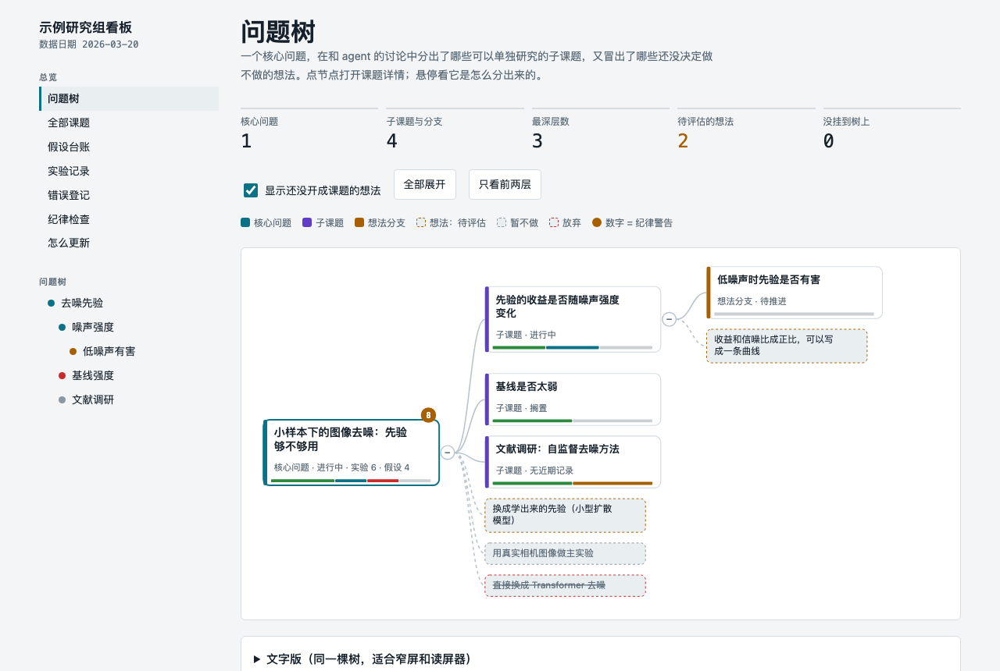
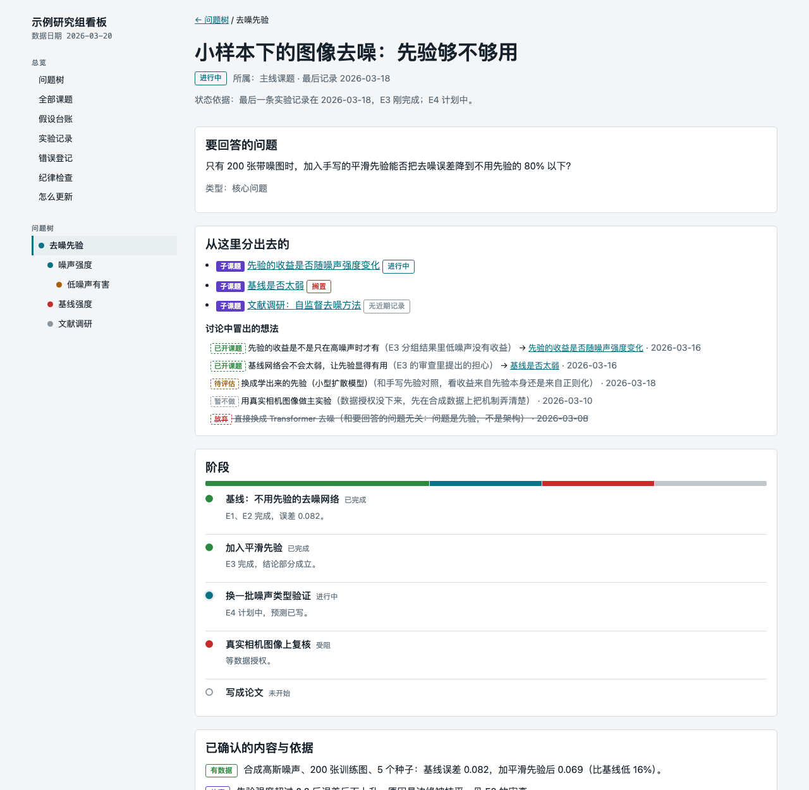
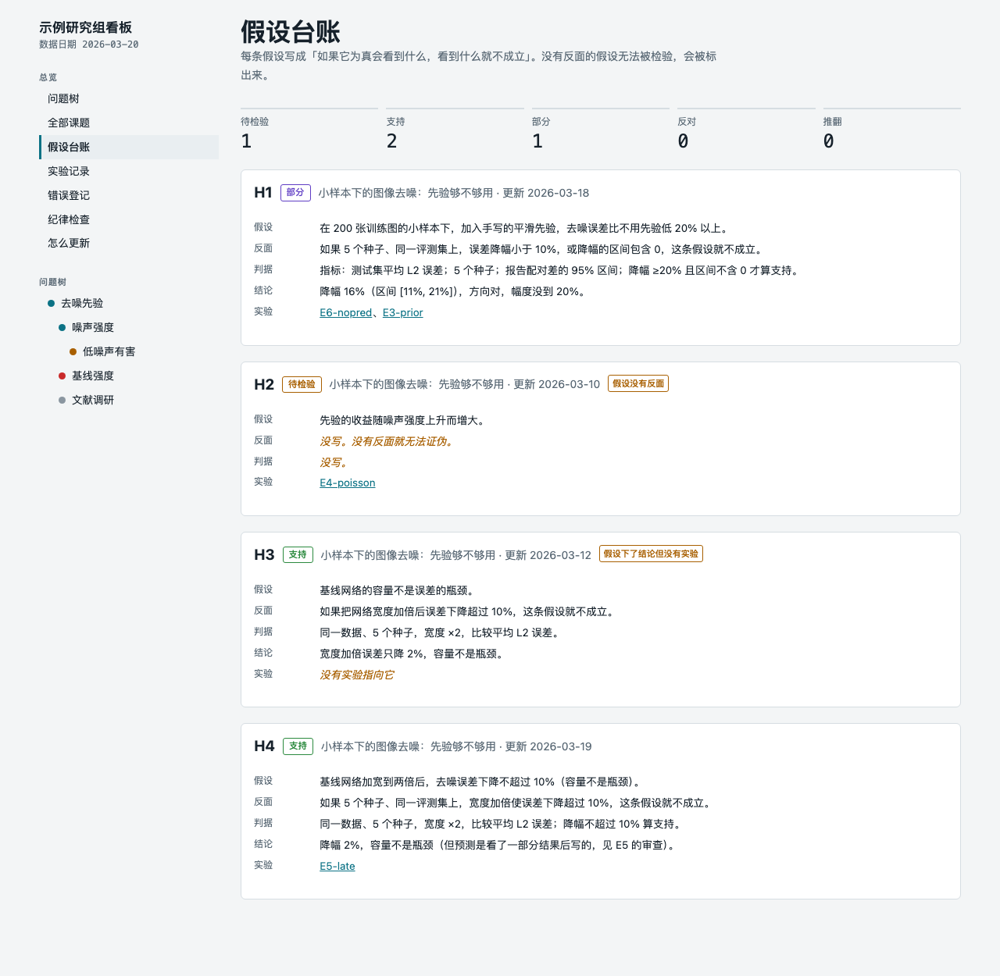

# research-tracker

**和 agent 围绕一个问题讨论，讨论出的子课题会自动长成一棵树。**

和 Claude Code 之类的 agent 一起做研究，通常是这样的：你抛出一个核心问题，几十轮讨论下来，它分出了好几个值得单独研究的子课题，冒出了一堆"也许可以试试"的想法，有些做了，有些放弃了，有些忘了。到最后你会遇到三个问题：

- **思路是一团。** 讨论里分出了哪些方向、哪个方向是从哪个结果引出来的、哪些想法被放弃了以及为什么，全埋在聊天记录里。
- **进度看不见。** 每个子课题做到哪、卡在哪、下一步是什么，要翻对话才知道。
- **agent 很会事后解释。** 实验跑完才说"其实我预期就是这样"，数字算错了悄悄改掉。

research-tracker 是一个 Claude Code skill，做三件事：

1. **把讨论整理成问题树。** 核心问题是树根，讨论中分出的子课题挂在下面，每条分叉记下"是在哪次讨论、因为什么分出来的"；还没决定做不做的想法挂在旁边，放弃的也留着并写明理由。
2. **一条命令生成一页看板**，首页就是这棵树的思维导图，点任意节点看那个子课题的进度、假设和实验。
3. **检查纪律**：哪个实验没有事前预测、预测写得比开跑晚、假设没有反面、子课题不知道从哪分出来。



## 问题树怎么长出来

和 agent 讨论时，每个新冒出的东西都有固定的去处：

| 讨论中发生的事 | 落成什么 | 树上看到什么 |
|---|---|---|
| 提出一个大问题 | **核心问题**（树根） | 最左边的节点 |
| "这个也许值得试试" | 先记成**想法**，状态"待评估"，写下为什么值得考虑 | 挂在旁边的虚线框 |
| "这个要单独研究" | 开成**子课题**，写 `parent`（从哪分出来）和 `origin`（因为什么） | 往右长出的新节点；原来那条想法标成"已开课题" |
| "这个不做了" | 想法改成"暂不做"或"放弃"，写理由 | 灰色或划掉的虚线框，**不删** |
| 子课题里又冒出新方向 | 再往下分，或先记成想法 | 树继续往右长 |

树上每个节点都能点开。详情页显示它在树上的完整路径、它是怎么分出来的、从它又分出去了什么，以及它自己的阶段、假设和实验：



## 每个子课题里：假设、实验、错误

| agent 说的话 | 落成什么 | 看板上看到什么 |
|---|---|---|
| "我猜 X 有帮助" | **假设**，必须同时写反面："如果看到什么，X 就不成立" | 假设台账：陈述、反面、判据、状态、哪些实验在检验它 |
| "我来试一下" | **实验**，开跑**之前**写预测和判否条件 | 实验记录：预测、配置、结果，可勾选多条并排对比，不同的配置项高亮 |
| "之前那个数字算错了" | **错误登记**：错在哪、怎么发现、怎么处理 | 错误页，并挂在被影响的实验和假设旁边 |

没写反面的假设、没有实验支持却下了结论的假设，会在台账里直接标出来：



## 它检查什么

19 项检查，覆盖问题树和这套方法的六条纪律（预测先写、假设带反面、对照口径一致、错误公开登记、证据分级、不凭印象）。最重要的几项：

- 实验没有**事前预测**，或预测的时间晚于开跑
- 预测在登记之后被**改动**
- 有预测但没有**判否条件**（什么结果会推翻它）
- 假设没有**反面**
- 已完成的实验没有**判定**或**审查**
- 假设已下结论，但没有任何实验指向它
- 课题久无记录，状态已经没有依据
- 子课题没写从哪分出来（`parent`），或没写为什么分出来（`origin`）
- 想法长期"待评估"，没人决定做不做


**警告不是处罚，是告诉你哪些结论目前还不能当结论。** 某一项不想要，在 `tracker.yaml` 的 `checks_off` 里关掉。

## 30 秒看效果

```bash
git clone https://github.com/zhanglr77/research-tracker.git
cd research-tracker
python3 scripts/init.py ~/my-research --demo      # 放入一组虚构的示例笔记
python3 scripts/build.py ~/my-research            # 生成 ~/my-research/看板.html
open ~/my-research/看板.html                       # macOS；其他系统直接双击打开
```

需要 Python 3.9 或更高版本（在 3.9 和 3.14 上跑过全部自带测试）。**不需要安装任何包，不联网。** 生成的 `看板.html` 是单个自包含文件，可以直接发给别人。

## 用在自己的研究上

### 作为 Claude Code 的 skill

把整个文件夹放到 `~/.claude/skills/research-tracker/`：

```bash
git clone https://github.com/zhanglr77/research-tracker.git ~/.claude/skills/research-tracker
```

之后对 Claude 说：

- "把我们刚才的讨论整理成问题树"
- "这个问题能分出哪些子课题？记到树上"
- "给我的研究做一个科研看板"
- "把这些实验日志整理成课题、假设和实验"
- "检查我的实验有没有事前预测"
- "我要开始一个新实验，先帮我把预测和判否条件写下来"

`SKILL.md` 告诉 Claude 怎么做：讨论中每冒出一个方向先记成想法，决定单独研究时才开成子课题并写明来源，放弃的想法留着写理由；整理旧材料时先读再拆，**不替你补没写过的预测**，回填的旧记录单独标出。

### 手动使用

```bash
python3 scripts/init.py ~/my-research --name "我的研究"
```

然后把 `assets/templates/` 里的四个模板复制到对应目录填写：

| 模板 | 放到 | 写什么 |
|---|---|---|
| `project.md` | `projects/` | 一个要回答的问题，它在树上的位置（`kind`、`parent`、`origin`），讨论中冒出的想法，几个阶段，卡点和下一步 |
| `hypothesis.md` | `hypotheses/` | 一条假设和它的**反面** |
| `experiment.md` | `experiments/` | **开跑之前**写预测和判否条件，跑完追加结果和审查 |
| `error.md` | `errors/` | 自己发现并改掉的错误 |

每次改完笔记，重新运行 `build.py`。笔记写错时，构建会一次列出全部问题（带文件名），不生成页面。

## 它不做什么

- **不替你做科研，也不判断科研对不对。** 它检查的是**记录的纪律**，不是**科学的正确性**。守全了所有纪律的研究，仍然可能是错的。
- **不防篡改。** 时间戳靠自觉；`.tracker-lock.json` 能发现无意中改了预测，防不住有意作假。需要的话把研究目录放进 git，并在开跑前提交一次。
- **不联网，不上传。** 没有遥测，没有外部请求。

## 方法来由

为什么是这六条纪律，每一条对应什么真实的失败，见 [`references/methodology.md`](references/methodology.md)。字段含义和 19 项检查的代码见 [`references/field-reference.md`](references/field-reference.md)。把已有的日志和聊天记录迁进来的做法见 [`references/porting.md`](references/porting.md)。

## 仓库结构

```
research-tracker/
  SKILL.md                 给 Claude 的指令
  scripts/                 init.py build.py check.py（只用标准库）
  assets/templates/        四种笔记模板
  assets/web/              看板的样式和脚本
  references/              方法来由、字段参考、迁移指南
  examples/demo/           虚构的示例笔记（故意触发每一类检查）
  tests/run_tests.py       自带测试：153 项，含问题树布局、无头浏览器交互和注入攻击样例
  docs/images/             README 里的截图
```

运行测试：`python3 tests/run_tests.py`（找不到 Chrome/Chromium 时，浏览器相关的一组会跳过并说明）。

## 许可

[MIT](LICENSE)
